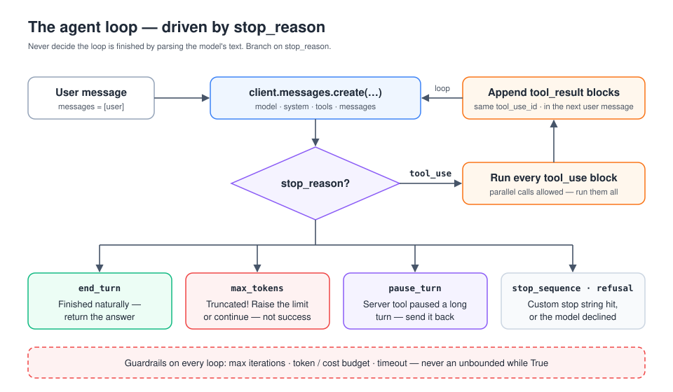
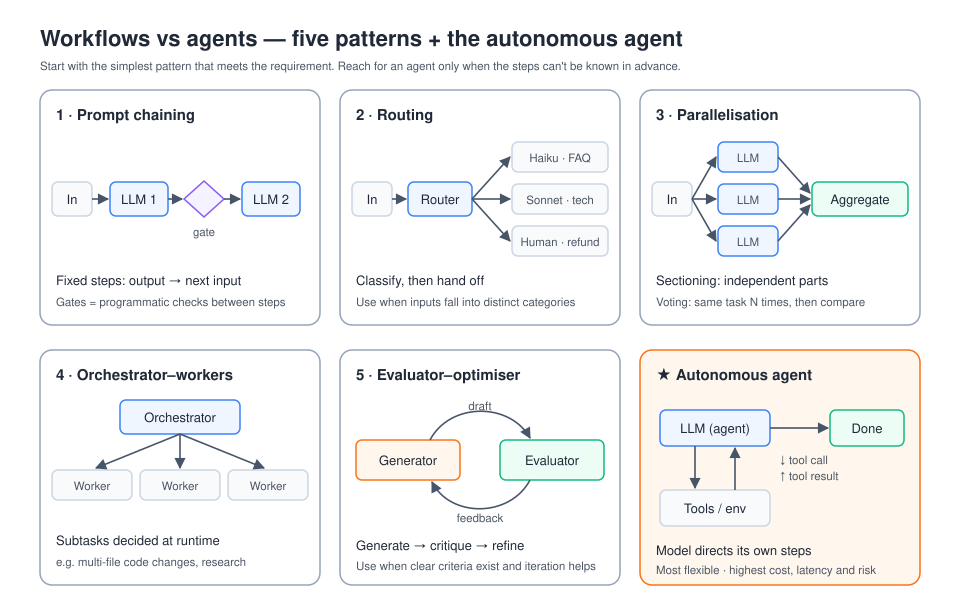
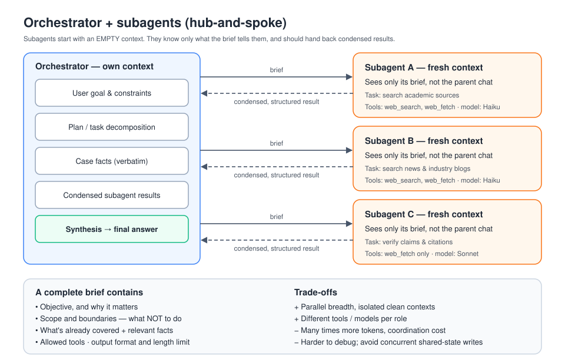
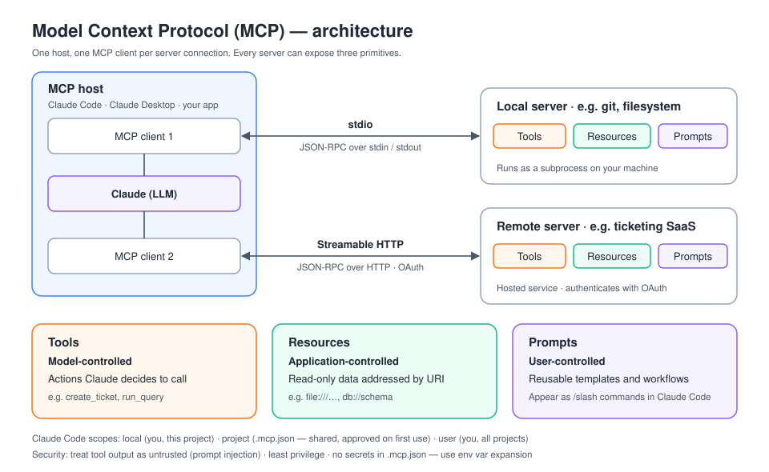
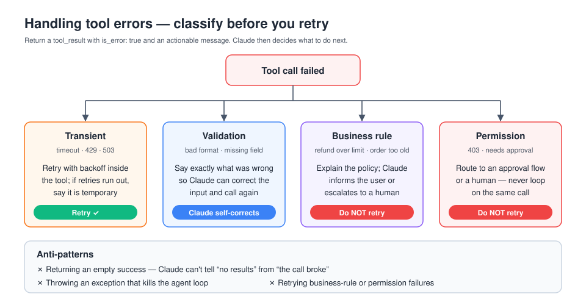
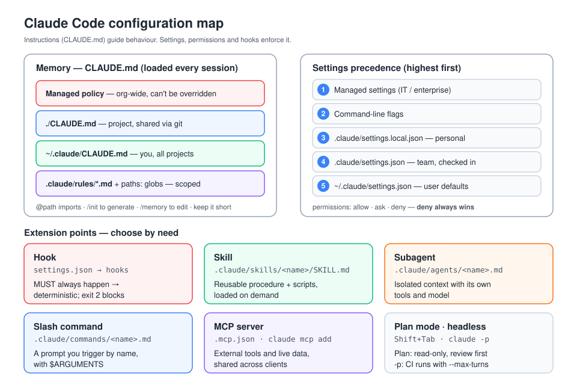
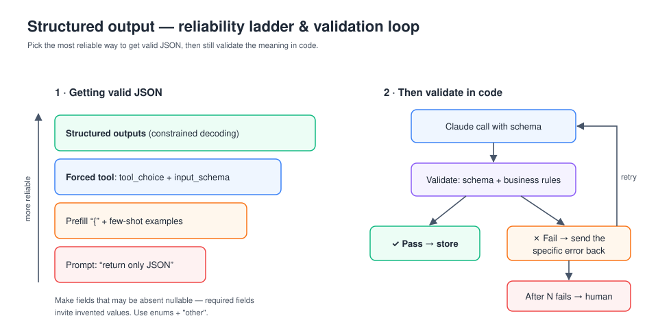
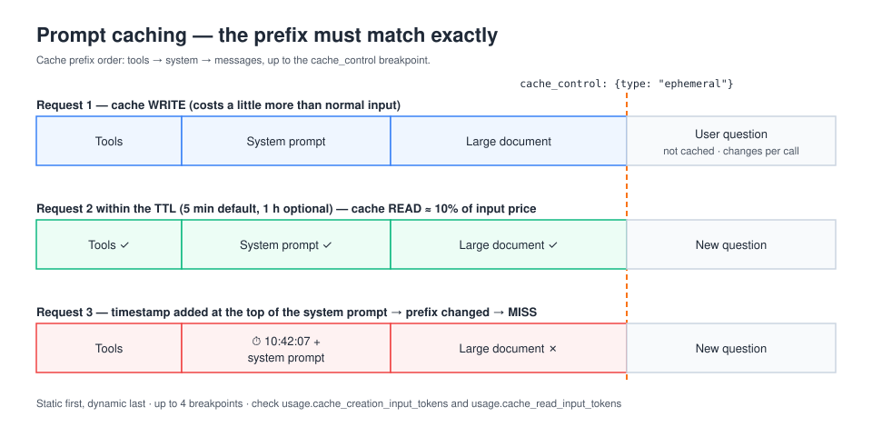
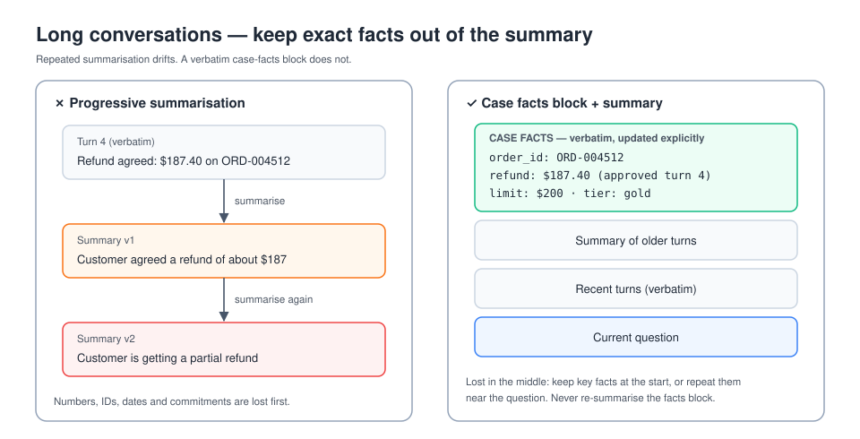

# CCAR-F Study Repo — Claude Certified Architect, Foundations

Personal study materials for Anthropic's **Claude Certified Architect – Foundations** exam (code **CCAR-F**, also written CCA-F).

> ⚠️ Anthropic has not published every exam detail publicly. The figures below come from community guides and should be checked against the official exam guide and the [Pearson VUE Anthropic page](https://www.pearsonvue.com/us/en/anthropic.html) before you book.

## Exam at a glance

| Item | Detail (reported) |
|---|---|
| Format | 60 scenario-based questions (multiple choice and multiple response) |
| Time | 120 minutes |
| Scenarios | Questions are grouped around production scenarios drawn from a pool |
| Pass mark | 720 / 1000 (scaled) |
| Delivery | Pearson VUE, online proctored or test centre, closed book |
| Cost | ~USD 125 (Claude Partner Network discounts reported) |
| Validity | 12 months |

## Domains

| # | Domain | Weight | Notes |
|---|---|---|---|
| D1 | Agentic Architecture & Orchestration | 27% | [domains/d1-agentic-architecture.md](domains/d1-agentic-architecture.md) |
| D2 | Tool Design & MCP Integration | 18% | [domains/d2-tool-design-mcp.md](domains/d2-tool-design-mcp.md) |
| D3 | Claude Code Configuration & Workflows | 20% | [domains/d3-claude-code.md](domains/d3-claude-code.md) |
| D4 | Prompt Engineering & Structured Output | 20% | [domains/d4-prompt-engineering.md](domains/d4-prompt-engineering.md) |
| D5 | Context Management & Reliability | 15% | [domains/d5-context-reliability.md](domains/d5-context-reliability.md) |

## Diagrams

| | |
|---|---|
|  |  |
|  |  |
|  |  |
|  |  |
|  | |

## Repo layout

```
README.md               this file
study-plan.md           4-week plan (with 2- and 8-week variants)
cheat-sheet.md          one-page last-minute review
resources.md            official docs and courses to read
domains/                deep notes, one file per domain
diagrams/               SVG diagrams (embedded in the domain notes)
practice/questions.md   scenario-style practice questions with explained answers
flashcards/cards.csv    flashcards (front,back,domain), importable into Anki
labs/                   hands-on exercises to do with the API and Claude Code
progress.md             tracker for scores and weak spots
```

## How to use this repo

1. Take the practice questions cold and record your score in [progress.md](progress.md).
2. Follow [study-plan.md](study-plan.md), weighting time toward D1 and your weakest domains.
3. Do the [labs](labs/README.md). The exam is scenario-based, so hands-on experience matters more than memorising facts.
4. Review with the flashcards each day and use the cheat sheet the night before.
