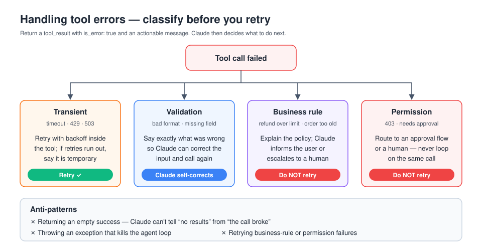
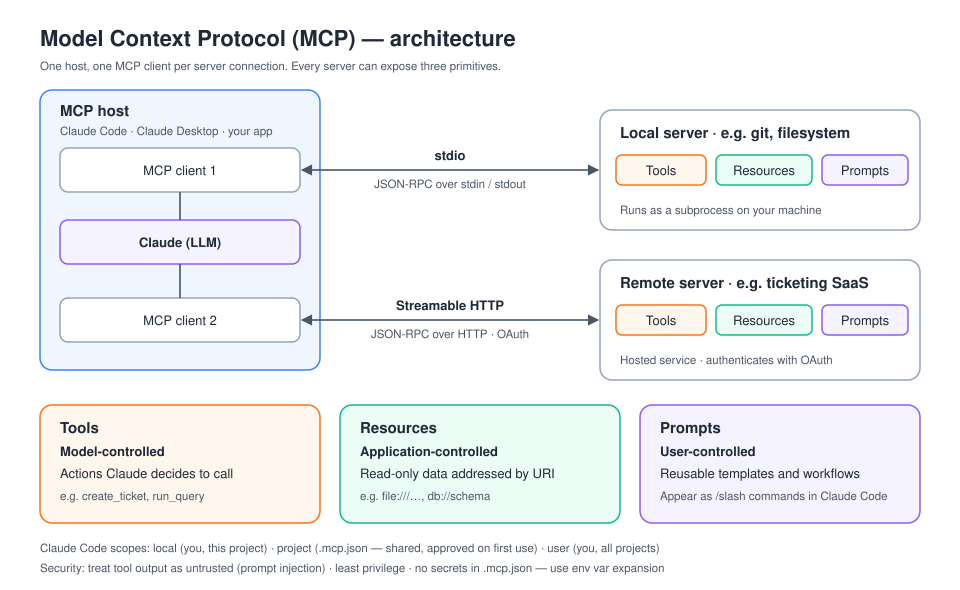

# D2 — Tool Design & MCP Integration (18%)

## 1. Tool definitions
```json
{
  "name": "get_order_status",
  "description": "Look up the current fulfilment status of a single customer order by its order ID (format ORD-123456). Returns status, carrier and ETA. Use this when the customer asks where their order is. Does NOT handle refunds; use issue_refund for those.",
  "input_schema": {
    "type": "object",
    "properties": {
      "order_id": {"type": "string", "pattern": "^ORD-\\d{6}$", "description": "Order ID, e.g. ORD-004512"}
    },
    "required": ["order_id"]
  }
}
```
- **The description is the most important part.** Claude chooses tools mainly from the name and description. Say what the tool does, when to use it, when *not* to, what each parameter means, its formats, and what it returns. Several sentences is normal.
- Use **specific, distinct names**. Overlapping tools such as `search` and `find` confuse selection, so merge them or make the difference explicit.
- Use the schema to **constrain inputs**: `enum`, `pattern`, `required`, numeric ranges. You can add `input_examples` for complex inputs.
- Return **high-signal output**: human-readable identifiers rather than opaque UUIDs where possible, pagination or truncation with a note, and no bloated raw dumps.
- **Number of tools:** selection accuracy and context cost get worse as the tool list grows. Group related tools, expose only what the current task needs (per-subagent tool sets), or use on-demand tool search and loading.

## 2. `tool_choice`
| Value | Behaviour |
|---|---|
| `{"type":"auto"}` | Default. Claude decides whether to call a tool. |
| `{"type":"any"}` | Must call *some* tool. |
| `{"type":"tool","name":"X"}` | Must call tool X. Used to force structured output. |
| `{"type":"none"}` | No tool calls allowed. |
- `disable_parallel_tool_use: true` limits the response to at most one tool call.
- When `tool_choice` is `any` or a specific tool, the response is prefilled to call it, so Claude writes no explanatory text before the `tool_use` block. Extended thinking only supports `auto` or `none`.

## 3. Tool errors



Return errors as a `tool_result` with `"is_error": true` and an **actionable message**. Claude can then recover by retrying, fixing input, asking the user, or choosing another path.

Useful error categories to distinguish (community guides cite four):
1. **Transient** (timeout, rate limit, 503): safe to retry with backoff, ideally inside the tool itself.
2. **Validation / bad input** (wrong format, missing field): tell Claude exactly what was wrong so it can correct the call.
3. **Business-rule / policy** (refund over limit, account locked): don't retry. Explain the rule and escalate or inform the user.
4. **Permission / auth** (forbidden, needs approval): don't retry. Route to a human or an approval flow.

Don't swallow errors, and don't return an empty success. Claude can't tell "no results" from "the call failed" unless you say so.

## 4. Client tools vs server tools
- **Client tools:** you define them and you execute them in your loop.
- **Server tools** (Anthropic-executed): web search, web fetch, code execution and similar. They run on Anthropic's side, and long runs can return `pause_turn`.
- **Anthropic-defined client tools** (bash, text editor, computer use, memory) have schemas built into the model, but your code still executes them.

## 5. Model Context Protocol (MCP)



- An open protocol for connecting LLM applications (**hosts/clients**) to external capabilities (**servers**).
- A server exposes three kinds of primitive:
  - **Tools** (model-controlled): actions or functions the model can call.
  - **Resources** (application-controlled): readable data or context identified by URI.
  - **Prompts** (user-controlled): reusable templated prompts and workflows, which appear as slash commands in Claude Code.
- **Transports:** `stdio` for local subprocesses, and **Streamable HTTP** for remote servers (which replaced the older HTTP+SSE transport). Remote servers usually use OAuth.
- In Claude Code: `claude mcp add <name> -- <cmd>` (stdio) or `claude mcp add --transport http <name> <url>`. Scopes are **local** (you, this project), **project** (`.mcp.json`, checked in and shared), and **user** (you, all projects). Claude Code asks for approval before using project-scoped servers.
- The Messages API also has an **MCP connector** (`mcp_servers` parameter) for remote servers without writing a client.
- **Security:** treat tool output as untrusted, since it can carry prompt injection. Grant least privilege, review third-party servers, and don't put secrets in `.mcp.json`. Use environment variable expansion instead.

## 6. Tools vs Skills vs MCP vs subagents
| Mechanism | Best for |
|---|---|
| Built-in tool | Generic capabilities already provided (file editing, bash, web search) |
| Custom tool / MCP tool | Taking an **action** or getting live data from an external system |
| MCP server | Reusable integration shared across clients and teams |
| **Skill** | Packaged **know-how and procedures** (instructions, scripts, templates) loaded on demand. Only the name and description sit in context until it's needed (progressive disclosure). |
| Subagent | Isolated context or different tools and permissions for a delegated subtask |
| Hook | **Deterministic** enforcement around tool calls or lifecycle events |

## 7. Common traps
- A vague one-line description, followed by "the model picks the wrong tool".
- Retrying a business-rule failure.
- Exposing 40 tools to every agent.
- Trusting content returned by a tool as instructions.
