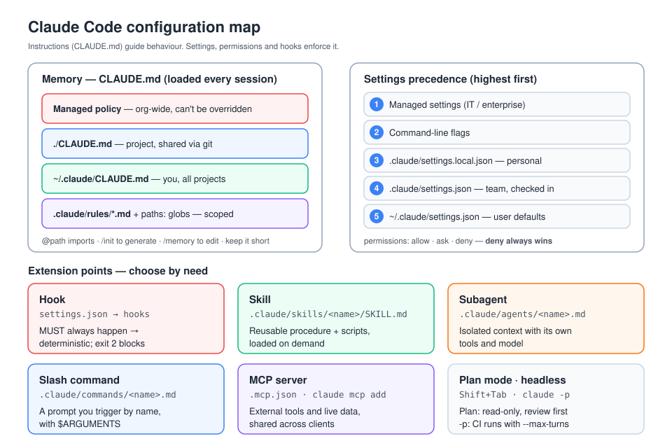

# D3 — Claude Code Configuration & Workflows (20%)

## 1. Memory: CLAUDE.md
| Level | Location | Shared? |
|---|---|---|
| Enterprise / managed policy | OS-level managed path (e.g. `/Library/Application Support/ClaudeCode/CLAUDE.md` on macOS) | Org-wide, can't be overridden |
| Project | `./CLAUDE.md` or `./.claude/CLAUDE.md` | Checked in, so the team shares it |
| User | `~/.claude/CLAUDE.md` | You, all projects |
| Local project | `./CLAUDE.local.md` (deprecated in favour of imports) | You only, git-ignored |

- Claude Code reads CLAUDE.md files **recursively upward** from the working directory, and loads files in **subdirectories** when it reads files there.
- More specific instructions take precedence over broader ones. Managed policy sits at the top.
- `@path/to/file` **imports** other files, with a maximum recursion depth.
- `/init` generates a starter CLAUDE.md, and `/memory` opens the memory files for editing.
- Keep it concise and specific: build and test commands, conventions, and "gotchas". It costs context on every session.
- **Path-scoped rules:** `.claude/rules/*.md` with YAML frontmatter `paths:` globs, such as `paths: ["src/api/**/*.ts"]`, apply only when working on matching files.

## 2. Settings and permissions
- Precedence, highest first: **managed** > command-line args > **local project** (`.claude/settings.local.json`) > **shared project** (`.claude/settings.json`) > **user** (`~/.claude/settings.json`).
- `permissions.allow` / `ask` / `deny` rules such as `"Bash(npm run test:*)"`, `"Read(./.env)"` and `"WebFetch(domain:example.com)"`. **Deny wins.**
- **Permission modes:** `default` (asks), `acceptEdits`, `plan` (read-only exploration that proposes a plan), and `bypassPermissions` (only in sandboxes or containers). Shift+Tab cycles modes.

## 3. Plan Mode
- Claude researches read-only, then presents a plan for approval before editing.
- Use it for multi-file or architectural changes, unfamiliar codebases, and anything you want reviewed before code is written. It's often unnecessary for one-line fixes.

## 4. Extension points
| Feature | Where | Notes |
|---|---|---|
| **Slash commands** | `.claude/commands/*.md` (project) or `~/.claude/commands/` | `$ARGUMENTS` and `$1`; frontmatter for `allowed-tools`, `description`, `model` |
| **Subagents** | `.claude/agents/*.md` | Frontmatter `name`, `description` (drives delegation), `tools`, `model`. Each has its **own context window**. |
| **Skills** | `.claude/skills/<name>/SKILL.md` | Frontmatter `name` and `description` are required, plus optional `allowed-tools`. Bundled scripts and references. Loaded **on demand** when the description matches the task. |
| **Hooks** | `hooks` in settings.json | Events: `PreToolUse`, `PostToolUse`, `UserPromptSubmit`, `Notification`, `Stop`, `SubagentStop`, `PreCompact`, `SessionStart`, `SessionEnd`. Matchers on tool name. Exit code **2 blocks** (stderr goes back to Claude), and JSON output can allow, deny or ask. |
| **MCP servers** | `.mcp.json` / `claude mcp add` | See D2 |
| **Plugins** | Marketplaces | Bundle commands, agents, skills, hooks and MCP servers |
| **Output styles** | `/output-style` | Change the system-prompt persona |

**When to use what:** use a hook for something that **must always** happen (format on save, block `rm -rf`, protect `.env`). Use a skill for a reusable procedure. Use a subagent for an isolated subtask or a noisy investigation. Use CLAUDE.md for always-relevant project facts.

## 5. Sessions and context
- `claude -c` continues the most recent session, and `claude -r` resumes a chosen session.
- `/clear` resets context between unrelated tasks. `/compact [focus]` summarises the history, and auto-compaction runs near the context limit.
- **Checkpoints:** Esc Esc / `/rewind` restores code and/or conversation to an earlier point. Checkpoints don't track changes made through bash commands or outside Claude Code, so they aren't a replacement for git.
- `/context` shows what's using the context window.

## 6. Headless and CI/CD
- `claude -p "prompt"` runs non-interactively (print mode).
- `--output-format json` or `stream-json` for parsing, `--max-turns N` to bound the run, `--allowedTools` / `--disallowedTools`, `--permission-mode`, and `--append-system-prompt`.
- GitHub Actions: `anthropics/claude-code-action`, which responds to `@claude` mentions and can review PRs.
- In CI, **pre-approve only the tools needed**, cap turns, run in a sandbox or container, and keep secrets in the CI secret store.

## 7. Recommended workflows
- **Explore → Plan → Code → Commit.**
- **Test-driven development:** write the tests, confirm they fail, commit them, then implement until they pass without changing the tests.
- Give Claude **verification targets** (tests, screenshots, linters).
- Run parallel work with **git worktrees** and several sessions.
- Use subagents to protect the main context during broad searches.

## 8. Common traps
- Putting a "never edit migrations" rule in CLAUDE.md when a `PreToolUse` hook or a deny rule is what actually enforces it.
- Storing personal preferences in the shared project settings.
- `bypassPermissions` on a developer laptop.
- Bloated CLAUDE.md files that waste context every session.
