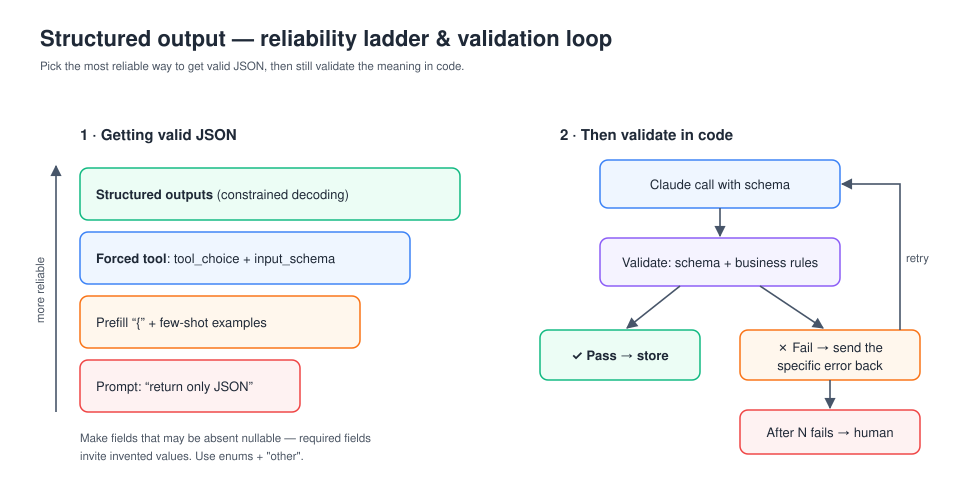

# D4 — Prompt Engineering & Structured Output (20%)

## 1. Core techniques (in Anthropic's recommended order of reach)
1. **Be clear and direct.** Give context: who the audience is, why the task matters, and what "done" looks like. Number the steps.
2. **Use examples (multishot).** 3–5 diverse, relevant examples wrapped in `<example>` tags. This is the best tool for consistent format and tone.
3. **Let Claude think.** Ask for chain of thought in `<thinking>` tags, or enable **extended thinking** with a `budget_tokens`. This helps with complex reasoning, but costs latency and tokens.
4. **XML tags** separate instructions, context, documents and examples, e.g. `<contract>`, `<instructions>`. Tag names are arbitrary but should be consistent.
5. **System prompt / role:** set the role and persistent rules in `system`. Put the task-specific content in the user turn.
6. **Prefill** the assistant turn to force a start, e.g. `{`. This isn't supported with extended thinking, and newer models may restrict it, so prefer structured outputs or tools.
7. **Chain prompts** for multi-stage tasks. Each step gets full attention and can be inspected.
8. **Long-context tips:** put long documents at the **top** and the query at the **end**, wrap each doc with source metadata, and ask Claude to quote the relevant passages before answering.

Also: tell Claude what **to do** rather than only what not to do, and explain *why* a rule exists so it can generalise. Newer models follow instructions precisely, so ask explicitly for the behaviour you want, e.g. "make the changes" rather than "can you suggest…".

## 2. Structured output options

| Approach | Reliability | Notes |
|---|---|---|
| "Respond in JSON" in the prompt | Lowest | Can drift, add prose, or break the schema |
| Prefill `{` plus examples | Medium | Cheap, but no guarantee |
| **Forced tool use**: define a tool whose `input_schema` is your schema and set `tool_choice: {"type":"tool","name":"record_x"}` | High | Read `tool_use.input` as the structured result |
| **Structured outputs** (`output_format` JSON schema, or `strict: true` tools, where supported) | Highest | Constrained decoding guarantees schema-valid output |

Even with schema-valid output, **validate the semantics in code** (business rules, cross-field consistency) and use a **retry loop**: send the validation error back to Claude ("Field `total` must equal the sum of line items; you returned…") and allow N retries before escalating.

**Design schemas for extraction:**
- Make fields **nullable/optional** when the source may not contain them. Required fields encourage made-up values.
- Use `enum`s with an `"other"` plus a free-text detail field.
- Add a `confidence` field or `evidence` quotes for review routing.

## 3. Reducing hallucination
- Allow Claude to say "I don't know" or "not found in the document".
- Ground answers in direct quotes and ask for citations, or use the **Citations** feature on document blocks.
- Restrict answers to the supplied context when that's what's required.
- Use best-of-N or self-consistency checks for high-stakes outputs.

## 4. Determinism and consistency
- Few-shot examples matter more than `temperature`. Lower temperature reduces variety but is not a guarantee.
- Fix the output format with schemas, and keep the prompt stable. Changes to the prompt prefix also break caching.
- Build **evals**: a test set with graded outputs (code-graded, LLM-graded with a rubric, or human). Define success criteria before iterating on the prompt.

## 5. The 4D framework (AI Fluency)
Anthropic's AI Fluency course: **Delegation** (what to hand to AI), **Description** (communicating clearly: product, process and performance), **Discernment** (evaluating outputs), and **Diligence** (responsibility, transparency, and accountability).

## 6. Common traps
- Using prompt-only JSON for a pipeline that must never break. Use forced tool use or structured outputs.
- Making every extraction field required, which leads to fabricated values.
- Burying the question above 100 pages of documents.
- Only negative instructions ("don't use markdown") without saying what to do instead.
