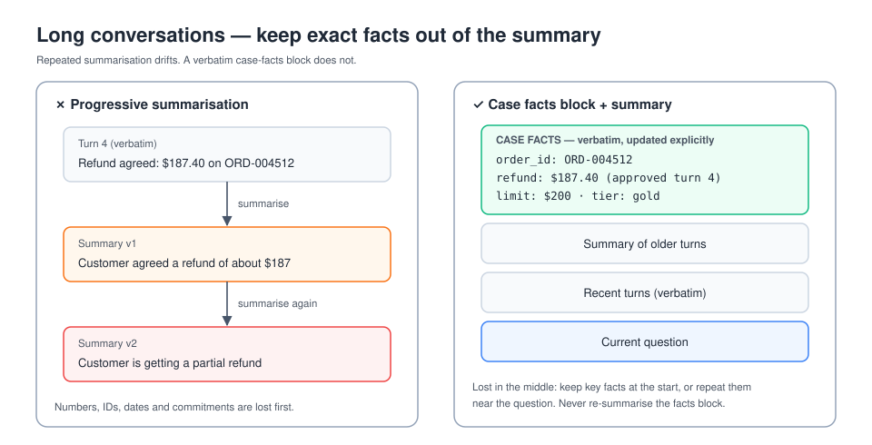
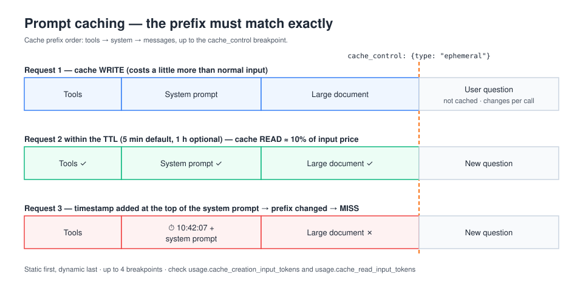

# D5 — Context Management & Reliability (15%)

## 1. The context window
- Everything counts: the system prompt, tool definitions, the message history, tool results, and thinking.
- More context isn't free. Cost and latency rise, and **attention dilutes** ("context rot").
- **Lost in the middle:** information buried in the middle of a long context is used less reliably than information at the start or end. Put critical facts at the **top** (or near the query at the end) and repeat key constraints close to the question.

## 2. Strategies for long-running agents

| Technique | How | Watch out for |
|---|---|---|
| **Compaction / summarisation** | Summarise old turns and continue with the summary | **Progressive summarisation loses detail.** Exact numbers, IDs, dates and commitments get paraphrased or dropped over successive summaries. |
| **Case facts block** | Keep a structured, authoritative block (customer ID, order numbers, amounts, policy limits, decisions made) that is **carried verbatim** and updated explicitly, never re-summarised | Keep it small. It is the source of truth. |
| **Tool-result clearing** | Remove or replace old bulky tool outputs once they've been used | Keep a reference so the data can be fetched again |
| **External memory / notes** | The agent writes progress to a file or the memory tool and reads it back later | Structure it, e.g. progress.md or a JSON state file |
| **Subagents** | Hand noisy exploration to a separate context and return a condensed result | The subagent needs a complete brief |
| **Just-in-time retrieval** | Keep identifiers (paths, URLs, IDs) and load the content only when needed | Retrieval latency |

## 3. Prompt caching

- Mark a stable prefix with `cache_control: {"type": "ephemeral"}` on a block. The cache covers tools, then system, then messages, **in that order**, up to that breakpoint.
- The default TTL is **5 minutes**, refreshed on each hit. A **1-hour** TTL is available at a higher write cost.
- **Cache writes** cost more than base input tokens, and **cache reads** cost far less (about 10%). Check `cache_creation_input_tokens` and `cache_read_input_tokens` in `usage`.
- There are up to 4 breakpoints, and a minimum cacheable length that depends on the model.
- **Any change in the prefix invalidates everything after it.** Put static content first (tools, system, big documents) and variable content last. Avoid timestamps or reordered tools in the prefix.
- The Python SDK type is `CacheControlEphemeralParam`.
- Good uses: long system prompts, large documents queried repeatedly, many-shot examples, and agent loops (the history grows but its prefix is stable).

## 4. Reliability engineering
- **Retries with exponential backoff and jitter** for 429 / 529 (overloaded) / 5xx. Respect `retry-after`. The SDKs retry automatically, and you can configure `max_retries`.
- **Timeouts and streaming** for long outputs. Use streaming for large `max_tokens` values to avoid HTTP timeouts.
- **Fallbacks:** another model, a degraded mode, or a human queue.
- **Idempotency:** make tools with side effects safe to retry, for example with idempotency keys.
- **Batch API (Message Batches):** about 50% cheaper and asynchronous, with results within 24 hours. Use it for non-urgent bulk work such as evals or backfills, not interactive chat.
- **Observability:** log prompts, tool calls, `stop_reason`, and token usage, and trace agent steps.
- **Guardrails:** validate inputs and outputs, screen for prompt injection, and enforce permissions in code.

## 5. Structured human-in-the-loop handoff
A good handoff contains: the **case facts**, the goal, the actions already taken (with results), the current blocker or decision needed, options with a recommendation, and confidence. The human should be able to act without reading the transcript.

## 6. Model selection for cost and latency
- **Haiku:** fast and cheap. Good for classification, routing, extraction at scale, and subagent workers.
- **Sonnet:** balanced default for most agents and coding.
- **Opus:** hardest reasoning, long-horizon agentic work, and orchestrators.
- Common pattern: a stronger orchestrator with cheaper workers, or route by difficulty.

## 7. Common traps
- Re-summarising the summary until the refund amount is wrong. Use a case facts block.
- Putting a timestamp at the top of the system prompt, which breaks the cache on every call.
- Using the Batch API for a latency-sensitive user feature.
- Retrying a 400 invalid-request error. Fix the request instead.
